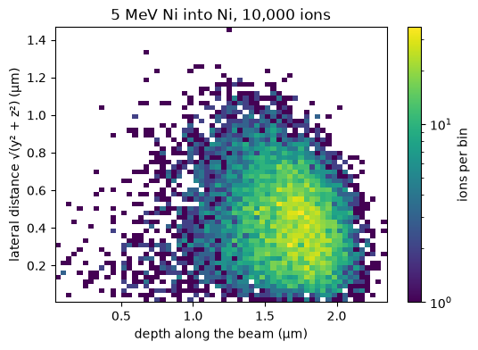
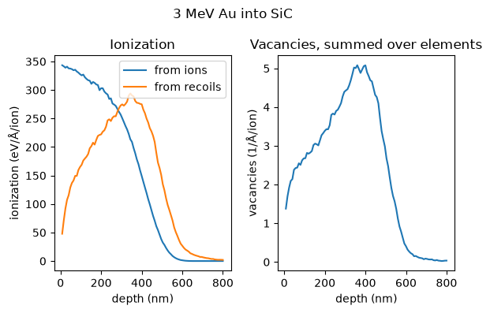
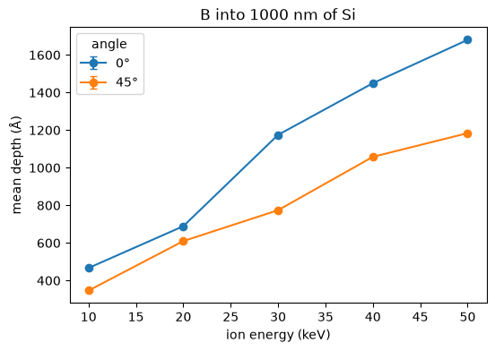
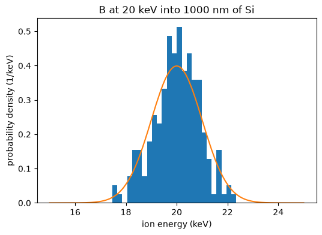

<p align="center">
  
</p>

# pysrim2: Automation, Analysis, and Plotting of SRIM Calculations

> **pysrim2 is a maintained continuation of
> [pysrim](https://gitlab.com/costrouc/pysrim) by Chris Ostrouchov.**
> See [what changed](https://pysrim2.readthedocs.io/en/latest/changes-from-pysrim.html).

[](https://pypi.org/project/pysrim2/)
[](https://github.com/FSIBT/pysrim2/actions/workflows/ci.yml)
[](https://pysrim2.readthedocs.io/en/latest/)
[](https://github.com/FSIBT/pysrim2/blob/main/LICENSE)
[](https://pypi.org/project/pysrim2/)
[](https://pypistats.org/packages/pysrim2)
[](https://github.com/FSIBT/pysrim2/pkgs/container/pysrim2)
[](https://github.com/astral-sh/uv)
[](https://github.com/astral-sh/ruff)
[](https://github.com/pre-commit/pre-commit)

SRIM (Ziegler's Stopping and Range of Ions in Matter) simulates how ions slow down and
stop in a material. pysrim2 runs SRIM from Python on Windows, Linux and macOS (macOS
through the container). Every output file is parsed into pandas tables. Parameter scans
run in parallel and are cached, beam distributions are supported, and plots are built in.
pysrim2 continues the original pysrim; see
[what changed](https://pysrim2.readthedocs.io/en/latest/changes-from-pysrim.html).

The import name is unchanged: `import srim`. Because both packages provide the
`srim` module, `pysrim2` cannot be installed alongside the original `pysrim`.

Documentation: <https://pysrim2.readthedocs.io/en/latest/>

# Get started

## Start in Python

Install the library, then the command line, which sets up SRIM once:

```bash
uv add pysrim2            # or: pip install pysrim2
uv tool install pysrim2   # the command line
pysrim2 install           # sets up SRIM (pysrim2 install --dry-run shows the steps)
pysrim2 doctor            # checks the result
```

The boron reference case (200 ions, 20 keV, 7 degrees, 100 nm of gold on silicon):

```python
from srim import TRIM, Ion, Layer, Target
from srim.analysis import implant_summary

target = Target([Layer.from_formula("Au", 19.3, 1000.0), Layer.from_formula("Si", 2.33, 10000)])
results = TRIM(
    target, Ion("B", energy=20e3), number_ions=200, angle_ions=7.0, ranges=1, random_seed=12345
).run()
print(implant_summary(results.range3d.df)["mean_depth_A"])  # about 282
```

Step by step, with the installation details, is in the
[first simulation](https://pysrim2.readthedocs.io/en/latest/first-simulation.html) and the
[installation guide](https://pysrim2.readthedocs.io/en/latest/installation.html). If you have
`pysrim` installed, remove it first. Python 3.11 or newer is required.

## Start with an AI agent

Install the pysrim2 skill for your coding agent (for example Claude Code). The skill needs
SRIM too, which `pysrim2 install` sets up:

```bash
pysrim2 install skill
```

Then give the agent a task, for example: *Simulate a 100 nm gold layer on a silicon wafer,
implant 200 boron ions at 7 degrees and 20 keV, and give me a pandas DataFrame of
implantation depth and xy straggle.* The agent writes and runs the script and reports a mean
depth of about 282 Å.

How the agent route works, with the example prompts, is in the
[agent guide](https://pysrim2.readthedocs.io/en/latest/agents.html).

# Gallery

<p align="center">
  <a href="https://pysrim2.readthedocs.io/en/latest/gallery.html#gallery-depth-profiles"></a>
  <a href="https://pysrim2.readthedocs.io/en/latest/gallery.html#gallery-scan-plot"></a>
  <a href="https://pysrim2.readthedocs.io/en/latest/gallery.html#gallery-beam"></a>
</p>

Every picture in the [gallery](https://pysrim2.readthedocs.io/en/latest/gallery.html) is made
by a script in the repository.

# Features

- **Output as DataFrames:** every SRIM output file is parsed into a pandas DataFrame with
  SRIM's units in the column names. See [DataFrames](https://pysrim2.readthedocs.io/en/latest/dataframes.html).
- **Run specs:** describe a calculation in a `run.yaml` and start it with `pysrim2 run`.
  See the [run spec](https://pysrim2.readthedocs.io/en/latest/run-spec.html).
- **Parameter scans:** run a grid or a list of points in worker processes, with a cache, so a
  rerun computes nothing new. See [scans](https://pysrim2.readthedocs.io/en/latest/scans.html).
- **Beam distributions:** ions with energy and position spreads, run as exact ion lists or in
  bins. See [beams](https://pysrim2.readthedocs.io/en/latest/beam.html).
- **Export:** Parquet, HDF5 and CSV, with the run's metadata. See
  [export](https://pysrim2.readthedocs.io/en/latest/export.html).
- **Container:** SRIM runs in a linux/amd64 container (Podman or Docker), which is how it runs on
  macOS. See the [container page](https://pysrim2.readthedocs.io/en/latest/container.html).

SRIM is not part of this package. SRIM © SRIM.com (James F. Ziegler) — free for non-commercial
use only; see `LEGAL.rtf`, which the installer keeps next to every copy. You do not need SRIM if
you only analyse existing output files.

# Citing

If you use pysrim2 in published work, please cite the paper about the original pysrim, on which
pysrim2 is based:

> Ostrouchov, C., Zhang, Y., Weber, W. J. (2018). pysrim: Automation, Analysis, and Plotting of
> SRIM Calculations. *Journal of Open Source Software*, 3(28), 829.
> https://doi.org/10.21105/joss.00829

This paper describes the original pysrim, not pysrim2. The software citation metadata is in
[`CITATION.cff`](https://github.com/FSIBT/pysrim2/blob/main/CITATION.cff), and the
[citing page](https://pysrim2.readthedocs.io/en/latest/citing.html) has the BibTeX entry and the
SRIM citation.

# Development

```bash
uv sync                          # set up the environment
uv run pytest                    # run the tests (from the repository root)
uv run pre-commit run --all-files   # lint and format
git config blame.ignoreRevsFile .git-blame-ignore-revs
```

The last command makes `git blame` skip the one-off formatting commit.
See [AGENTS.md](https://github.com/FSIBT/pysrim2/blob/main/AGENTS.md) for commit conventions. Bug reports and pull
requests are welcome at <https://github.com/FSIBT/pysrim2>.

# Credits

pysrim was written by [Chris Ostrouchov](https://gitlab.com/costrouc)
with contributions from [Alex Hanson](https://gitlab.com/wahanson) and
[dschwen](https://github.com/dschwen). pysrim2 includes fixes from many
fork authors, listed in
[changes from pysrim](https://pysrim2.readthedocs.io/en/latest/changes-from-pysrim.html).
Everyone with commits is listed in [`CITATION.cff`](https://github.com/FSIBT/pysrim2/blob/main/CITATION.cff).

# License

MIT. See [LICENSE](https://github.com/FSIBT/pysrim2/blob/main/LICENSE). SRIM is licensed separately by its author.
