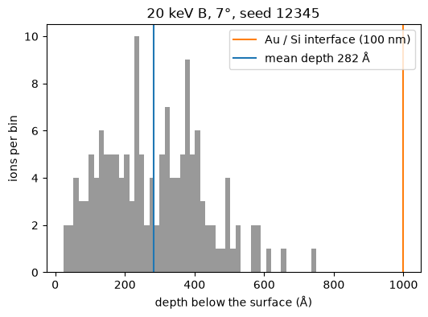

# Agent guide

pysrim2 ships a skill, `SKILL.md`, that teaches coding agents (Claude Code and
others that read `SKILL.md` folders) how to run SRIM through pysrim2: build a
target and ion, run TRIM or SR, read the results, and run it in the
{doc}`container`. It includes a runnable example (boron into gold on silicon).
The skill is shipped inside the wheel.

## Install the skill

Install the command line and set up SRIM, the container (on macOS) and the skill:

```shell
uv tool install pysrim2
pysrim2 install            # SRIM, wine or container, and the skill
pysrim2 doctor             # everything should be [ok]
```

To install only the skill, run `pysrim2 install skill [--agent claude|all] [--scope user|project]`.
It goes to the places below.

| Option | Destination |
|---|---|
| default (`--agent claude --scope user`) | `~/.claude/skills/pysrim2/` |
| `--scope project` | `<current folder>/.claude/skills/pysrim2/` |
| `--agent all` | also `~/.agents/skills/pysrim2/` |

It is part of the default `pysrim2 install`. Re-running updates a copy pysrim2
wrote earlier; a skill folder it did not write is never overwritten unless you
pass `--yes`. `pysrim2 doctor` reports an installed copy that is out of date.

The skill is for agents that *use* pysrim2. If you want an agent to *work on*
pysrim2 itself, it should read
[`AGENTS.md`](https://github.com/FSIBT/pysrim2/blob/main/AGENTS.md) in the
repository, which is for contributors.

## Example prompts

Give the agent a task in plain language. Three examples:

- "Simulate a 100 nm gold layer on a silicon wafer, implant 200 boron ions at 7
  degrees and 20 keV, and give me a pandas DataFrame of implantation depth and
  xy straggle."
- "How far do 1 MeV helium ions travel in silicon? Give me the stopping table."
- "Run a full-cascade TRIM calculation for 100 keV Ni into 50 nm Au / 500 nm Si /
  Al and plot the vacancy profile."

## What the agent does

1. It runs `pysrim2 doctor`. If something fails, it follows the `fix:` line, or
   uses the container (see {doc}`container`).
2. It writes a short script with `srim.Layer`, `Target`, `Ion` and `TRIM` or `SR`,
   and runs it, natively or in the container with the script's folder mounted at `/data`.
3. It parses the results as DataFrames: `results.vacancy.df`, `results.ioniz.df` and
   so on (or `results.to_dataframes()`; `collision` only with
   `include=["collision"]`), the per-ion final positions in `results.range3d.df`
   (with `ranges=1`), and `srim.analysis.implant_summary` for the range and
   straggling in SRIM's definitions. The columns are in {doc}`dataframes`.
4. For full cascades (`calculation=2`, `collisions=2`) it streams `COLLISON.txt`
   with `results.collision.iter_events()` instead of loading it, and exports in
   chunks with `results.collision.to_parquet(path, chunk_rows=100_000)` (needs
   `pysrim2[parquet]`).
5. For a reproducible, shareable run, it writes a `run.yaml`
   (`trim.to_yaml("run.yaml")`) and runs it with
   `pysrim2 run run.yaml --set ion.energy_keV=30`; see
   [the run.yaml example](https://github.com/FSIBT/pysrim2/blob/main/examples/scripts/run_yaml_example/README.md)
   and {doc}`run-spec`.

## Drive pysrim2 through MCP

`pysrim2 mcp` is a [Model Context Protocol](https://modelcontextprotocol.io) server.
Any MCP client (Claude Code, Codex, Gemini CLI, Cursor, VS Code, or another client that
starts a stdio server) can start it and then set up, run and read pysrim2 runs in the
conversation you already have. The server runs under your own account, needs no API key,
no account and no network access, and listens on no port: it talks over stdin and stdout
with the client that started it. The one other connection is the local socket of the pysrim2
window, when it is open (see [With the pysrim2 window open](#with-the-pysrim2-window-open)).

### Install

The server needs the MCP Python SDK, which is an extra (`mcp>=2.3,<3`):

```shell
uv tool install "pysrim2[mcp]"        # or: pip install "pysrim2[mcp]"
pysrim2 install                       # SRIM, as for the scripts
pysrim2 doctor                        # everything should be [ok]
```

Without the extra, `pysrim2 mcp` prints how to install it and exits with 2. The
extra is also part of `pysrim2[app]` and `pysrim2[all]`.

### Connect a client

`pysrim2 mcp --print-config CLIENT` prints the configuration that starts the server for
that client. The text goes to standard output, so you can redirect it, and the file it
belongs in goes to standard error.

| `CLIENT` | Put it in |
|---|---|
| `claude` | run the one line it prints in a terminal (`claude mcp add --scope user pysrim2 -- …`) |
| `codex` | `~/.codex/config.toml` |
| `gemini` | `~/.gemini/settings.json` |
| `cursor` | `~/.cursor/mcp.json` |
| `vscode` | `.vscode/mcp.json` (the `servers` form) |
| `generic` | the stdio server entry of any other client: the command, then its arguments |

For example, for Claude Code:

```shell
pysrim2 mcp --print-config claude
```

Every snippet starts the absolute path of the `pysrim2` executable that printed it (or
`python -m srim mcp` when `pysrim2` is not on the PATH). If you move or reinstall pysrim2,
print the snippet again. Newer VS Code documentation also describes a `.mcp.json` file with
an `mcpServers` object; `vscode` prints the `.vscode/mcp.json` form with `servers`, so check
your VS Code version's documentation if the server does not appear.

The server sends the client short instructions for the agent, and offers the full pysrim2
guide (the skill) as the resource `pysrim2://skill`. Whether the agent reads them depends on
the client. You can also install the skill as a file with `pysrim2 install skill` (see above).

Relative paths in the tools (a `run.yaml`, an export folder) are resolved from the
directory the server was started in, which your client chooses. Use absolute paths when
in doubt.

### With the pysrim2 window open

When the pysrim2 window is open and **Allow agents to connect** is on (the **Agent** menu, on by
default), the same server works through the window, and the agent's session goes on as before. An
edit appears in the window as one undo step labelled `agent: …`, a run in **Progress**, a plot in
**Results**, and every call in the **Agent activity** panel. Results and plots are read from the run
folder in both modes, and each result has a `mode` (`app` or `headless`), so the agent can say which
one answered. The window's side is described in {doc}`app` (The agent).

Two things change while the window is open:

- **Closing the window.** The agent carries on without it. A read-only call is answered without the
  window. An edit or a run reports that the app closed, and the agent calls again to continue
  headless; the first answer after that says the setup now comes from the last saved file, so
  changes made only in the window are not in it. Opening the window again switches back to it, and
  the next answer says the setup now comes from the app.
- **Asking.** A question is a dialog in the window rather than a prompt in the chat. **Deny** is the
  default button, and a request with no answer in two minutes is denied. No confirm code is issued
  in this mode.

#### Security

The window listens on a local socket that only your user account can reach, and it has no network
port. Its discovery file, `<data dir>/app/agent.json`, is private to you (mode 0600) and holds a
random token. `pysrim2 mcp` connects only when it reads that file and presents the token; the token
never goes on a command line or into a log. On Windows the file is protected by your profile folder,
and the named pipe by Qt's user-access option.

### What the agent can do

The server has 25 tools and one resource. The agent sees their names and descriptions;
these are the groups:

- **Status:** `status` (is SRIM ready, the doctor's checks, the setup's file, the latest run).
- **Setup:** `get_setup`, `set_values` (keys as in `--set`, for example `ion.energy_keV=40`),
  `set_section` (whole sections: `ion`, `target`, `run`, `scan`), `open_setup`, `new_setup`,
  `save_setup`. A bad value comes back as an error with the library's message, and the setup
  does not change.
- **Looking up input:** `lookup_element` (an element or isotope, such as `N15`), and
  `find_material` (a compound with its formula and density, such as `SiO2`). Use these
  rather than guessing a density or a composition.
- **Runs:** `estimate`, `start_run`, `run_status`, `control_run` (pause, resume, stop),
  `list_runs`, `open_run`, `delete_run`.
- **Results:** `summary` (the implant summary, which needs the range output, `settings.ranges=1`),
  `available_plots`, `table` and `plot` (see below), and `export` (CSV, Parquet or HDF5).
- **Install:** `install_plan` and `install_step`.
- **Undo and redo:** `undo` and `redo` step back and forward through the window's history, and only
  through the agent's own steps: when your own edit is on top, the agent is refused. Without the
  window they return an error that says so.

`start_run` takes optional `workers` and `batch_ions`. With `batch_ions`, each point is split
into batches that run in parallel, as with a scan's `batch_ions` (see {doc}`scans`); the
numbers are then equally valid but not those of an unbatched run.

Tables are capped: `table` returns at most `max_rows` rows (500 by default, 5000 at most). A
depth profile is thinned evenly over its depths; a per-ion table gives its first rows, and
`capped` says when rows were left out. Plots and summaries read a per-ion output only up to
the desktop app's row limit (200 000 rows), so a plot never reads a whole large output.

`plot` draws the picture and returns it to the agent as an image, with the path of the file.
The file is a PNG in `<run folder>/plots/`; in a scan with several points it is named
`<key>-point<index>.png`.
Plots need matplotlib: `pip install "pysrim2[plot]"`. Export writes the tables as CSV or
Parquet files in a folder, or as one HDF5 file; big per-ion outputs are written in chunks.
Parquet needs `pysrim2[parquet]` and HDF5 needs `pysrim2[hdf5]`.

### A conversation

This is the N15 request as a conversation. The calls are shown in short; the numbers
come from the tools, and the agent reports them.

> **You:** simulate N15 into a 200 nm SiO2 layer with 1 µm Si behind it. The energy
> should be 40 keV of the N. Give me the depth profile.
>
> **Agent:** calls `status` (SRIM is ready, mode "headless"), `lookup_element("N15")`
> (the mass of N-15) and `find_material("SiO2")` (silicon dioxide, density 2.2 g/cm³).
> It then calls `set_section("target", …)` with the SiO2 layer (200 nm) and the Si layer
> (1 µm), and `set_values` with `ion.symbol=N`, the N-15 mass, `ion.energy_keV=40` and
> `settings.ranges=1`. It asks how many ions to use; you say 1000.
>
> **Agent:** calls `estimate`, then `save_setup("n15-sio2.yaml")`. The file is new, so nothing
> is asked. The run is short, so `start_run` starts it without a question. The run folder is
> `n15-sio2-runs/<UTC time>/`, and the run goes on even if the conversation ends.
>
> **Agent:** calls `run_status` until the status is `finished`, then `plot(key="range_profile")`.
> The picture comes back, and the agent tells you it is saved as
> `n15-sio2-runs/<UTC time>/plots/range_profile.png`. It reports the mean depth from `summary`.

### What asks first

Some actions need your OK before they happen. Everything else (editing the setup, reading
results, starting a run below the limits, pausing and stopping) just happens.

| Action | Asks when |
|---|---|
| `start_run` | the run is estimated to take longer than `agent_max_minutes` (30 by default), or it wants more workers than `agent_max_core_fraction` of the cores (one half by default); or starting would save unsaved changes into a setup file this session did not create |
| `save_setup` | the file exists and this session did not write it, or it is a symbolic link (always) |
| `open_setup`, `new_setup` | the current setup has unsaved changes that would be discarded |
| `export` | an output file exists and this session did not write it (this includes files inside a CSV or Parquet folder), or it is a symbolic link |
| `delete_run` | always |
| `install_step` | always; the question lists the steps and their commands |

Admin installer steps are never run by the server: `install_plan` lists their commands, and
you run them in a terminal yourself. The non-admin steps of `install_step` run in their own
process, not in the server. The limits are settings in `<data dir>/app/settings.json` (see
[Limits](#limits-and-settings)).

#### How you answer

- **The pysrim2 window** (when it is open): the question is the window's dialog, as described
  above. Deny is the default; the client's own prompt is not used.
- **A client that supports elicitation** (on the 2025-11-25 protocol version) shows you the
  question in its own prompt: allow or deny.
- **A client on the 2026-07-28 protocol version, or one without elicitation,** cannot be asked
  in the middle of a call. The tool refuses and returns "needs the user's OK" with a
  `confirm_code`. The agent then asks you in the chat, and only if you agree, repeats the call
  with the same arguments and the code.

In headless mode, the code path **trusts the agent to really ask you**. The server cannot see the chat, so a
code can only be as good as the agent's question; read what it asks before you agree. A code is
single use, works only for that action (the tool, its arguments, the setup's file and content,
and the number of workers), expires after 5 minutes, and lives in memory: a restarted server
issues new ones.

Other rules of the questions:

- An unanswered prompt times out after 5 minutes and counts as no. So does a denial, a
  malformed answer, or the client declining the prompt.
- A refusal is final. The agent must not retry the call, split it, or find another way to do
  the same thing; it reports the refusal to you.
- If the call is cancelled while the question is open, nothing is started.
- In headless mode other tools keep working while a question is open. In app mode the question
  is the window's dialog, and the agent's other requests wait for its answer. The dialog gives up
  after two minutes, so the wait is at most that long.
- Two `start_run` calls each ask, and each one that you allow can start its own run.

Every request and answer goes into the activity log.

### Runs outlive the agent

A run started through the server is a detached process: it keeps going if the agent, the
client or `pysrim2 mcp` exits. Its folder is `<setup stem>-runs/<UTC time>/`, next to the
setup, and holds `scan.yaml`, the events of the run in `events.jsonl`, the control requests
in `control.jsonl`, the process id in `runner.json`, its output in `runner.log`, and the
points' outputs. A new `pysrim2 mcp` finds the runs through the setup's `-runs` folder:
`list_runs(setup_path)` lists them, and `run_status`, `control_run` and `summary` work on
them. A run's status is `running`, `paused`, `finished`, `stopped`, `failed` or `crashed` (its
process went away without finishing).

A run in progress cannot be deleted; stop it first.

A run started while the window is open belongs to the window: it stops when the window quits (the
window asks first), and the agent pauses or stops it through the window. Its folder has the same
files, and `runner.json` says `"backend": "app"`, so `run_status` and `summary` still read it after
the window has moved on. A run folder that the window has open or is running cannot be deleted
either; open another run in the window first.

### The activity log

Every tool call adds one line to `activity.jsonl` in `<data dir>/agent/`. The data directory
is `~/Library/Application Support/pysrim2` on macOS, `$XDG_DATA_HOME/pysrim2` (by default
`~/.local/share/pysrim2`) on Linux, `%LOCALAPPDATA%\pysrim2` on Windows, and `$PYSRIM2_HOME`
when it is set. A line holds the time, the mode, the client's name and version, the tool, what
it did, what it asked and how it was answered, and any error. The one-time codes are never
written to the log. The file is private to your user, and it moves to `activity.jsonl.1` when
it passes 1 MB.

### Limits and settings

The two ask-first limits are in `<data dir>/app/settings.json` (the same file the desktop app
keeps its settings in):

- `agent_max_minutes`: a run estimated longer than this needs your OK. Default `30`; whole
  minutes from 1 to 10080.
- `agent_max_core_fraction`: more workers than this share of the cores needs your OK. Default
  `0.5`; a number above 0 and at most 1.

The estimate uses the ions-per-second rate remembered for the calculation type
(`ions_per_s` in the same file), or a built-in default for that type. The same file holds
`agent_socket`, the **Allow agents to connect** switch (on by default); with it off, no window
is reached and the server works headless.

What the server does not do:

- It does not listen on a network port. An agent on another machine cannot reach it; run
  `pysrim2 mcp` on the machine where pysrim2 and SRIM are.
- It does not run admin installer steps.
- It does not undo or redo without the window, because the undo history lives in the desktop app.

If `status` says SRIM is not ready, it returns the problem, and `install_plan` lists what is
missing.

## The result of the first prompt

For the first prompt (200 ions, `random_seed=12345`) the mean implantation depth is
about **282 angstrom**, and the lateral straggling (SRIM's definition) is about
**242 angstrom**. The picture below is the depth of the ions from that run, with the
Au/Si interface and the mean depth marked. The {ref}`gallery entry <gallery-agent_boron>`
has the script that makes it.



The agent can start from the boron script, which is the same file the skill ships as
its example. It is in `examples/scripts/` in the repository, and here it is:

```{literalinclude} ../examples/scripts/boron_in_gold_on_silicon.py
:language: python
```

Runnable scripts for the current API, natively or in the container, are in
[examples/scripts](https://github.com/FSIBT/pysrim2/tree/main/examples/scripts); see
{doc}`examples` for the list.

SRIM © SRIM.com (James F. Ziegler) — free for non-commercial use only; see `LEGAL.rtf`.
