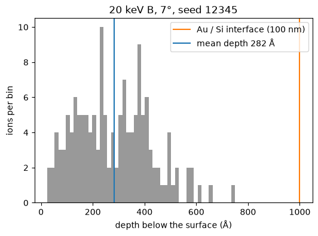

# Agent guide

pysrim2 ships a skill, `SKILL.md`, that teaches coding agents (Claude Code and
others that read `SKILL.md` folders) how to run SRIM through pysrim2: build a
target and ion, run TRIM or SR, read the results, and run it in the
{doc}`container`. It includes a runnable example (boron into gold on silicon).
The skill is shipped inside the wheel.

## Install the skill

Install the command line and set up SRIM, the container (on macOS) and the skill:

```shell
uv tool install pysrim2
pysrim2 install            # SRIM, wine or container, and the skill
pysrim2 doctor             # everything should be [ok]
```

To install only the skill, run `pysrim2 install skill [--agent claude|all] [--scope user|project]`.
It goes to the places below.

| Option | Destination |
|---|---|
| default (`--agent claude --scope user`) | `~/.claude/skills/pysrim2/` |
| `--scope project` | `<current folder>/.claude/skills/pysrim2/` |
| `--agent all` | also `~/.agents/skills/pysrim2/` |

It is part of the default `pysrim2 install`. Re-running updates a copy pysrim2
wrote earlier; a skill folder it did not write is never overwritten unless you
pass `--yes`. `pysrim2 doctor` reports an installed copy that is out of date.

The skill is for agents that *use* pysrim2. If you want an agent to *work on*
pysrim2 itself, it should read
[`AGENTS.md`](https://github.com/FSIBT/pysrim2/blob/main/AGENTS.md) in the
repository, which is for contributors.

## Example prompts

Give the agent a task in plain language. Three examples:

- "Simulate a 100 nm gold layer on a silicon wafer, implant 200 boron ions at 7
  degrees and 20 keV, and give me a pandas DataFrame of implantation depth and
  xy straggle."
- "How far do 1 MeV helium ions travel in silicon? Give me the stopping table."
- "Run a full-cascade TRIM calculation for 100 keV Ni into 50 nm Au / 500 nm Si /
  Al and plot the vacancy profile."

## What the agent does

1. It runs `pysrim2 doctor`. If something fails, it follows the `fix:` line, or
   uses the container (see {doc}`container`).
2. It writes a short script with `srim.Layer`, `Target`, `Ion` and `TRIM` or `SR`,
   and runs it, natively or in the container with the script's folder mounted at `/data`.
3. It parses the results as DataFrames: `results.vacancy.df`, `results.ioniz.df` and
   so on (or `results.to_dataframes()`; `collision` only with
   `include=["collision"]`), the per-ion final positions in `results.range3d.df`
   (with `ranges=1`), and `srim.analysis.implant_summary` for the range and
   straggling in SRIM's definitions. The columns are in {doc}`dataframes`.
4. For full cascades (`calculation=2`, `collisions=2`) it streams `COLLISON.txt`
   with `results.collision.iter_events()` instead of loading it, and exports in
   chunks with `results.collision.to_parquet(path, chunk_rows=100_000)` (needs
   `pysrim2[parquet]`).
5. For a reproducible, shareable run, it writes a `run.yaml`
   (`trim.to_yaml("run.yaml")`) and runs it with
   `pysrim2 run run.yaml --set ion.energy_keV=30`; see
   [the run.yaml example](https://github.com/FSIBT/pysrim2/blob/main/examples/scripts/run_yaml_example/README.md)
   and {doc}`run-spec`.

## The result of the first prompt

For the first prompt (200 ions, `random_seed=12345`) the mean implantation depth is
about **282 angstrom**, and the lateral straggling (SRIM's definition) is about
**242 angstrom**. The picture below is the depth of the ions from that run, with the
Au/Si interface and the mean depth marked. The {ref}`gallery entry <gallery-agent_boron>`
has the script that makes it.



The agent can start from the boron script, which is the same file the skill ships as
its example. It is in `examples/scripts/` in the repository, and here it is:

```{literalinclude} ../examples/scripts/boron_in_gold_on_silicon.py
:language: python
```

Runnable scripts for the current API, natively or in the container, are in
[examples/scripts](https://github.com/FSIBT/pysrim2/tree/main/examples/scripts); see
{doc}`examples` for the list.

SRIM © SRIM.com (James F. Ziegler) — free for non-commercial use only; see `LEGAL.rtf`.
