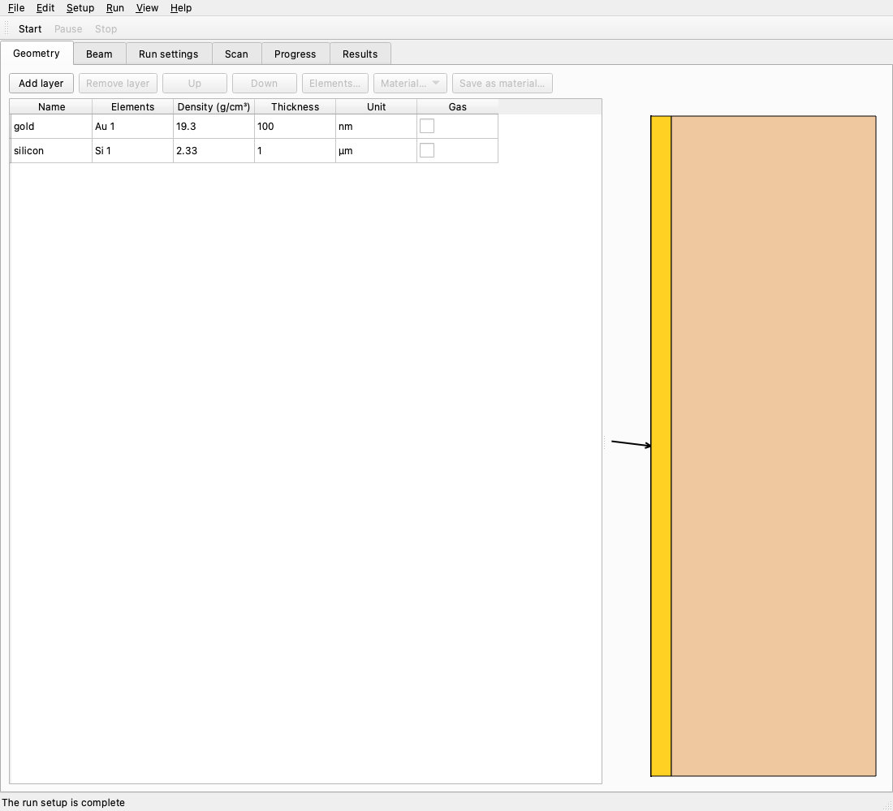
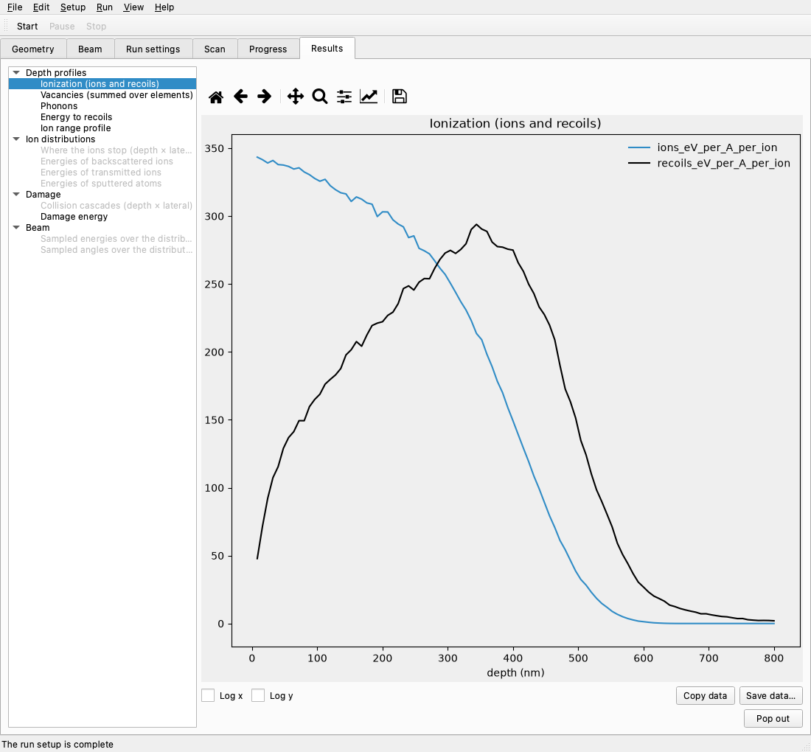

# Desktop app

`pysrim2 app` opens a window for pysrim2. It guides you through setting up SRIM: it shows how
SRIM runs on your machine, installs what is still missing, and checks the result. It also edits
a run setup: the target (Geometry tab), the beam (Beam tab), the run settings (Run settings tab)
and an optional scan (Scan tab). It runs the setup, shows the run as it goes (Progress tab), and
shows and saves the results (Results tab).



The app is optional. The library (`import srim`) and the command line never import Qt, so
they work without it.

## Install

The app needs the `app` extra (PySide6, the Qt bindings, and matplotlib). PySide6 is a download of over 100 MB (about 340 MB installed), so it is an extra rather than part of the default install, and the container image stays small. Install it into the pysrim2 you already use:

```shell
pysrim2 install app
```

`pysrim2 install app` runs the install that matches how pysrim2 was installed. A
`uv tool` install is reinstalled with the extras it has plus `app`; a pip install gets
`pysrim2[app]` at the same version. You can also install the extra directly:

```shell
uv tool install "pysrim2[app]"
pip install "pysrim2[app]"
```

In a source checkout (an editable install) the command does not run anything; it prints
`uv sync --extra app` for you to run in the checkout.

The app needs Python 3.14 or older for now: PySide6 does not support Python 3.15 yet. On
Python 3.15 the `app` extra installs nothing, and `pysrim2 install app` and `pysrim2 app`
say so. Use Python 3.14 for the app, for example `uv tool install --python 3.14 "pysrim2[app]"`.

Installing the app needs no administrator rights.

## Start

```shell
pysrim2 app
```

If the app is not installed, the command says so and asks you to run `pysrim2 install app`.

## Setup

The setup opens by itself on the first check if no route is chosen yet or a check is not
ready. A route saved on another machine, or one this platform does not offer, counts as no
route until you choose one; the app does not change the settings file at startup. You can
reopen it at any time from the **Setup** menu (**Run setup…**), or by
clicking the setup link in the status bar.

The setup has four pages: **Welcome to pysrim2**, **Choose how SRIM runs**, **Install what
is missing** and **Check the installation**.

SRIM runs in one of three routes:

| Route | What it does | Offered on |
|---|---|---|
| Native TRIM.exe | Runs SRIM's own `TRIM.exe` (Windows only) | Windows |
| Wine (pysrim2's own wine prefix) | Runs `TRIM.exe` under wine, in pysrim2's private prefix | Linux only |
| Container (Podman or Docker) | Runs SRIM inside the pysrim2 container image | Every platform |

The route that is recommended on your machine is marked "(recommended)" and selected
first. A route you chose before is preselected instead. On macOS only the container route is
offered, with a note that native SRIM is not supported there.

On the install page each step is listed as installed, to install, or needs admin rights.
**Install** runs the steps that need no administrator rights. **Check again** plans the
steps once more and checks them again.

The app never runs a command that needs administrator rights (for example the package
installs or `regsvr32` on Windows). It shows those commands in a box instead: use
**Copy commands**, run them in a terminal, then press **Check again**. The install and the
check are the same as in the command line (see {doc}`cli`), so `pysrim2 install` in a
terminal can also finish what the app left.

**Finish** saves the route. **Cancel** changes nothing. Back, Cancel and closing the
wizard are unavailable while an install runs.

## Status bar

The status bar at the bottom of the window says what to do next, one line at a time. It lists,
in this order:

- *Choose how SRIM runs: open the setup* until a route is chosen, and a line for each check
  that is not ready, in the form `<check>: <detail>. Fix: <what to run>`.
- What the run setup still needs (for example *Choose the ion: pick an element on the Beam
  tab*), then the problems the library finds in it. A note that does not stop a run comes
  last.
- *The run setup is complete* when nothing is listed.

The first line is a link when it names a place: clicking it opens the setup, or the tab and the
field it names. When there are more lines, the bar says how many more, and its tooltip lists
all of them.

## Geometry

The **Geometry** tab edits the layers of the target. The table has one row per layer; the
first row is the layer the beam reaches first. Its columns are:

| Column | What it holds |
|---|---|
| Name | A name for the layer (optional; the cell is blank when there is none) |
| Elements | The elements and their amounts, for example `Si 1, O 2`; an isotope shows as `Si-28 1` |
| Density (g/cm³) | The density |
| Thickness | The thickness, shown in the layer's unit |
| Unit | The unit of the thickness: Å, nm, µm or mm (the value is stored in nm) |
| Gas | Ticked for a gas layer |

Type a number into a cell and press Enter. A comma works as a decimal point (`1,5` is 1.5).
Text that is not a number is refused and the old value stays. An empty cell is a missing value:
the status bar names it. A value the library cannot use (for example a negative thickness) is
shown in red, with the library's message as its tooltip.

**Add layer**, **Remove layer**, **Up** and **Down** change the layers; you can also drag a row
to a new place. **Elements…** opens the elements of the selected layer in a dialog, with one row
per element: the element (**Choose…**, which opens the periodic table), its amount, and its
displacement, lattice and surface energies in eV. Each new element starts with SRIM's usual
values (amount 1, displacement 25 eV, lattice 0 eV, surface 3 eV).

**Material…** fills the selected layer from a menu. Its first part is the common materials
(by name; each one's formula and density come from `srim/data/compounds.yaml`); its second part,
**My materials**, is what you saved before. A material replaces the layer's name, density, gas
flag and elements. **Save as material…** keeps the selected layer's density, gas flag and
elements under a name you choose; saving a name that exists replaces that material. My materials
are stored in `materials.json` in pysrim2's data directory, in the `app` folder (`<data
dir>/app/materials.json`, see {doc}`installation`). A file that cannot be read counts as no
materials.

The periodic table has one button per element, Z = 1 to 92 (SRIM's range). An element's menu
has **Natural** first, which is SRIM's own mass for the element, the same as a scripted run gets
when it names no mass. The other entries are the element's natural isotopes, most abundant first,
and choosing one sets that mass for the ion or the element. Only an isotope is stored with a mass;
natural elements are stored without one.

Beside the table the **target** is drawn to scale. Each layer's width follows its thickness,
the beam comes in from the left at its angle, and a click on a layer selects its row (and a row
selects its layer). A thin layer next to a thick one is still drawn a few pixels wide so that it
stays visible and clickable. Such a layer is drawn wider than to scale: it has a dashed outline,
a "≠" mark and a tooltip that says so. A layer with no usable thickness is drawn the same way. When
there are more layers than fit at that width, each gets an equal width and none is to scale. The
picture is only a guide: the numbers in the table are the setup.

## Beam

The **Beam** tab sets the ion, the number of ions and the beam quantities. The **Ion** button
opens the periodic table, with the isotopes as on the Geometry tab. **Number of ions** is a whole
number of at least 1.

Each beam quantity has its own editor: **Energy** (keV), **Angle** (degrees), **Azimuth**
(degrees) and the position **Position y**, **Position z** and **Depth** (nm). Energy and angle
have no **Not set** choice, but an energy that is missing is named by the status bar. Azimuth and
the three positions are **Not set** by default, which leaves them out of the setup. Setting one
position coordinate creates the position, with the other two at 0.0. **Not set** on a coordinate
removes the whole position when the other two are 0.0 (or Not set); otherwise that coordinate is
stored as 0.0.

Each quantity has a **Kind**:

- **Fixed value** is one number.
- **Gaussian** (mean, sigma), **Uniform** (low, high), **Triangular** (low, mode, high) and
  **Log-normal** (mu, sigma) are the distributions. The parameters are those of the
  {doc}`beam` guide.
- **Python function** takes a reference written as `python:<module>:<name>`, for example
  `python:my_beams:density`. The module must be importable by its name from the folder you run
  from, so put it next to your script. A function in `__main__`, a lambda and a function made
  inside another function are refused, because a worker process cannot import them.
- **Histogram file** is read with **Load…**. The file's bars are shown in a preview, and **OK**
  uses it (**Cancel** keeps the setup as it was). A file that is broken (one row, decreasing
  edges, values that are not numbers) is refused with the library's message.

A distribution (every kind but a fixed value) also has **Limit to**, with optional low and high
bounds: values outside the range are not sampled.

Under each editor the density of that quantity is drawn: a smooth curve for a distribution, and a
step line for a histogram or a uniform distribution. A binned beam also marks its bin edges with
dashed lines. A value the library refuses is not drawn. The tab scrolls, so all six plots can be
reached in a small window.

A setup with a distribution, an azimuth or a position is a **distributed** beam, and the tab then
shows the **Beam mode**. A single energy and angle is one SRIM run, and the tab says so instead.
The modes are:

- **Automatic** (the default) is exact for calculations 1 and 2, and binned for the others. The
  line under the choice says which one it picked and why.
- **Exact (TRIM.DAT)** samples every ion from the distributions and runs SRIM once, with the
  sampled ions in SRIM's `TRIM.DAT` file. One SRIM run holds up to 99 999 ions; a larger exact
  beam is split into several runs by `srim.beam.run_beam` (see {doc}`beam`).
- **Binned** splits the beam into bins of energy and angle and runs SRIM once per bin. **Energy
  bins** and **Angle bins** set the number of bins (**Automatic** is 10 and 6, up to 2000). The
  count can be edited only for a distributed energy or angle, and only when it is binned. A
  setup whose bins are written as edges keeps them, and the count shows without being editable.

For the meaning of the modes and of the sampling, see {doc}`beam`. For the file itself, see
{doc}`run-spec`.

**Histogram files and saving.** A histogram file is read from the folder of the setup when it is
relative to it. When you save, a histogram file that lies outside the folder of the saved
`run.yaml` is copied into a `beam/` folder next to it, and the setup refers to the copy (a
second file with the same name becomes `name-2.txt`, and so on). The setup then opens when its
folder moves. A histogram file that cannot be found stops the save with a message.

## Run settings

The **Run settings** tab sets the calculation and the options that SRIM reads from `TRIM.IN`.
Each control stores one item in the setup, and the library writes it to the `TRIM.IN` line
named here:

| Control | Setup item | `TRIM.IN` line |
|---|---|---|
| Calculation | `calculation` (1 Quick, 2 Full cascades, 3 Monolayer) | cascade options |
| Random seed | `seed` | cascade options |
| Description | `settings.description` (no double quote) | target |
| Ranges, Backscattered ions, Transmitted ions, Sputtered atoms | `settings.ranges`, `backscattered`, `transmit`, `sputtered` (0 or 1) | disk files |
| Collisions | `settings.collisions` (0, 1 or 2) | disk files |
| EXYZ.txt from | `settings.exyz` (eV; Off is 0) | disk files |
| Bragg correction | `settings.bragg_correction` (default 1.0) | ion |
| Autosave every | `settings.autosave` | ion |

The number of ions is on the Beam tab (`number_ions`); it is written on the ion line of `TRIM.IN`.

A setting that is set back to its default is removed from the setup, and so is the `settings`
mapping when it becomes empty, so the setup holds only what differs from SRIM's defaults. A
`run.yaml` written by `TRIM.to_spec()` always lists `description` and `ranges`, even at their
defaults. The `TRIM.IN` file is the same either way: the library writes every setting to it.
Settings the tab does not show (for example `plot_mode`) and a calculation 4 to 7 from a file
are kept as they are. A calculation 4 to 7 is shown as "SRIM calculation N" in the menu.
The tab has no field for `plot_mode`, `plot_xmin`, `plot_xmax`, `reminders` or `version`: they
are kept as they are and are edited in `run.yaml`, so a status bar line about one of them opens
the tab but has no field to focus.

## Undo, open and save

The window edits one run setup at a time, kept in a `run.yaml` file (the same file the library
reads with `RunSpec.from_yaml`):

- **File > New setup** (Ctrl+N) starts an empty setup.
- **File > Open setup…** (Ctrl+O) reads a `run.yaml`.
- **File > Save setup** (Ctrl+S) writes the setup to the file it came from; a new setup is saved
  with **Save setup as…** (Ctrl+Shift+S), which asks for a file.

A setup opened and saved without edits keeps the same contents. Anything the editors do not offer
(for example calculations 4 to 7, a `fixed` beam shape, or `settings.plot_mode`) is kept as it
is; the Beam tab shows a value it does not offer as YAML, and it stays until you choose another
kind.

Saving refuses an incomplete setup and says what is missing first, and a setup the library refuses
is saved only once it is fixed. A file that cannot be read or written gives a message, and the
setup stays as it was.

**Edit > Undo** and **Redo** (the standard keys of your platform) go back and forward through
the edits since the setup was opened or created (the last 200). Each change to a field is
one edit, so a typed number is one step once you press Enter or leave the field. Opening another
file starts a new history, so Undo never returns to the setup that was open before.

New, Open, Open recent, Open run folder and Quit ask **Discard the changes to this setup?** when the
setup has edits that are not saved. Choosing No keeps the setup and the window open.

## Scans

The **Scan** tab turns the setup into a scan: the same run for many values of a parameter. Tick
**Run as a scan** to add one; unticking it removes the scan. A setup without a scan is one run.

- **Parameters to vary** is a table with one row per parameter. Each row has a parameter (a list of
  the usual ones, or **Other…** for any parameter by its name, for example `ion.energy_keV` or
  `target.0.thickness_nm`) and its values, typed and separated by commas, semicolons or spaces.
  **Range…** fills the values from a start, a stop and a number of values, in linear or logarithmic
  steps (logarithmic needs both ends above zero). **Add row** and **Remove row** change the table.
- **Ions** is either a **Fixed number of ions** per point or a **Precision target**: the scan runs
  batches until the error of the chosen value is within the relative or absolute error, between a
  minimum and a maximum number of ions, in batches of **Ions per batch**. The ions per point are
  separate from the number of ions on the **Beam** tab, which is the number of a single run.
  **Batch of ions** splits a point into batches of that size; **One run per point** (the default)
  does not split it.
- **Values from each point** ticks the values to extract (for example `implant_summary`,
  `sputter_yield` or `energy_to_recoils`). `vacancy_at` (a depth in nm) and `ions_in_layer` (a layer,
  0 for the surface) need their parameter, which the tab asks for. The values become the columns of
  the scan's table and the choices of the Summary on the Results tab.
- **Random seed** is the seed of the scan. Left blank, the scan draws a seed for each point.

Some things are shown but not changed here: explicit points from a file, a `python:` extractor, an
extractor the tab does not offer, and **keep_seed** (a line that says a single run uses the setup's
own seed). The library judges every value: a number the tab cannot read is refused and its text
stays, and the status bar names what the scan still needs.

## Running

**Run > Start** (Ctrl+R, or **Start** on the toolbar) runs the setup. If the setup has no file yet,
or has changes that are not saved, Start saves it first (asking for a file when it is new); when you
cancel that, nothing starts. A setup the library refuses says why and does not start.

A run that is estimated to take more than two minutes is offered parallel workers in a dialog, on a
machine with at least two cores. The estimate uses the ions per second that the app measured before
for the setup's calculation (kept in `settings.json`, see Settings file), or a default for each
calculation. The dialog says how long the run may take and how many units of work it has (a binned
beam has one unit per bin). Its choices are:

- **Run in parallel** runs with the number of **Workers** (one core is left free by default).
  **Split into batches of** splits a single point with more than 1000 ions into batches that run at
  the same time. Batches use different random numbers than one run, so the results agree
  statistically, not point for point; the dialog says so. **Run in containers** is offered when a
  container runtime is installed and the run is estimated at an hour or more.
- **Run as one** runs in one worker, as an ordinary run does.
- **Cancel** starts nothing.

A run writes to a **run folder** next to the setup, named after it: `<setup name>-runs/<UTC time>/`,
for example `boron-runs/20261112T101500Z/`. A second run in the same second gets `-2`, `-3` and so on.
The folder holds the scan (`scan.yaml`), one folder per point (`points/<id>/`) with the SRIM outputs,
and, once the run has finished, `result/scan.csv`. It is the same as a scan folder of the library
(see {doc}`scans`).

While a run goes the setup is locked: its editors, Start, File > New setup, Open setup, Open recent,
Open run folder and Undo and Redo are unavailable. The **Progress** tab opens by itself.

- **Pause** (Run > Pause, a check box) holds back the points that have not started; clear it to go on.
- **Stop** kills the points that are running and keeps the points that have finished. The run ends as
  stopped, and its results are the points that finished.
- **Quit** during a run asks **A run is going. Stop it and quit?** Yes stops the run, waits for it to
  end (up to thirty seconds) and then quits; No keeps the window and the run open.

The ions per second that the run measured for the setup's calculation are saved when the run ends, so
the next estimate is closer.

## Progress

The **Progress** tab shows the run as it goes, and as it ended, until the next run starts:

- the summary line, with the elapsed time and the estimated time left, and the number of points that
  are done, running, queued, cached, failed or stopped;
- the workers, each with the point it runs and its ions per second;
- a table of the points, with the status, ions and values of each. A click on a column heading sorts
  the points by that column, and a second click reverses the order;
- **Open log** opens the `error.log` of the selected point, or of the last point that failed, in the
  desktop's default program;
- **Warnings and errors (newest first)**, the last twenty.

Pause and Stop on this tab are the Run actions. A run folder that is opened later (see Recent runs
below) shows its final state here.

## Results

The **Results** tab draws the plots of a run's results. A single run has one point, and the tab shows
its plots directly. A scan lists its points in a **Point** box, one at a time; a point that failed is
not listed. The plots are in groups:

- **Depth profiles**: ionization, vacancies, phonons, energy to recoils and the ion range profile.
- **Ion distributions**: where the ions stop (needs `RANGE_3D.txt`), and the energies of the
  backscattered and transmitted ions and of the sputtered atoms.
- **Damage**: the collision cascades (needs `COLLISON.txt`) and the damage energy.
- **Beam**: the energies and angles sampled over the distributions of an exact run.
- **Scan** (for a scan only): the **Summary** and the overlays (below).

A plot that the points cannot give is greyed out, and its tooltip says what it needs (for example
*needs RANGE_3D.txt; enable 'Ranges (RANGE_3D.txt)' in Run settings*). Plots are read from the outputs
of the run, and the per-ion files are read only up to 200 000 rows, so a plot of a very large run is
drawn from its first rows.



Selecting a plot draws it once. A running run draws the shown plot again every few seconds: the
interval is `refresh_seconds` in `settings.json` (5 by default). Before any result exists the tab says
**No results yet.**, and when every point failed it says why.

Under the plot, **Log x** and **Log y** change the scales, and the toolbar moves, zooms and saves the
picture. **Copy data** puts the plot's data on the clipboard as CSV, and **Save data…** writes the same
CSV to a file. **Pop out** opens the plot in a window of its own, which closes with the main window.

The **Scan** group of a scan has two kinds of view:

- **Summary** plots an extracted value (the **y** box) against a parameter (the **x** box), with one
  line per value of a parameter in the **colour** box (or none). The error of a value is drawn as an
  error bar when the scan has one. During a run the summary follows the points as they finish.
- An **Overlay** for each depth profile draws one curve per point. Tick the points to draw them, or
  narrow the list with the **Filter**, a condition such as `ion.energy_keV` > 10. At most twelve curves
  are drawn: with more ticked, the note says *Showing 12 of N curves; use the filter to choose*.

Each point keeps the same colour, line style and marker in every plot of the scan, so a point can be
followed from one plot to the next. A finished exact run's sampled ions are drawn over the densities
of the **Beam** tab.

When the setup has changed since the run, the Results tab shows **From the previous setup**. The
results are still the run's; the banner says the setup is not the one that ran. Undoing the change
hides the banner.

A run folder that did not finish (it was stopped or crashed) is shown with the points that have
results, and the status bar says *This run did not finish; showing the points that have results.*

## Saving results

**File > Save results…** saves the last finished run's results in the library's formats. It is
available after a run has finished (not for a run folder that did not finish), and not while a run
goes. The dialog asks for:

- a **Folder** (**Browse…**) and a **Name**;
- the **Formats**: **Parquet** (a folder of tables), **HDF5** (one file), **CSV** (a folder of tables
  with their metadata) and the **SRIM output files** (copied unchanged). Parquet needs the `parquet`
  extra of pysrim2 (pyarrow) and HDF5 the `hdf5` extra (tables); a format whose extra is not installed
  is greyed out, and its tooltip names the extra;
- **Include collision details (can be large)**: the collision table of each point, written in chunks.
  It is off by default;
- for a scan, **All points** or **Chosen points**, with the points to save.

With a name `N`, a plain run writes `N.parquet/`, `N.h5`, `N-csv/`, `N-raw/` (the outputs of the point,
`*.txt`, `TRIM.IN`, `TRIM.DAT` and `run.yaml`, copied unchanged) and `N-run.yaml` (the run's
`scan.yaml`). A scan writes its table as `N-scan.parquet` or, in HDF5, as the table `scan` of `N.h5`;
its CSV is `N-scan-csv/`; each chosen point is written under `N-<id>`, where `<id>` is the first eight
characters of the point's id. Nothing in the run folder is changed.

Before it writes anything, the save checks every file it would write. If one exists, the dialog asks
before it is replaced, and only the files the save would write are removed. The save runs in a
thread, and its status line says *Saving…*.

## Recent runs

**File > Open recent** lists the last ten setups and run folders, newest first. A setup is recorded
when it is opened or saved, and a run folder when its run ends. The list is kept in `recent.json` in
the app's folder (see Settings file). An entry that cannot be opened now is greyed out, and its
tooltip says why: the file or the folder was moved or deleted, or the folder is not a pysrim2 run
folder.

**File > Open run folder…** opens a run folder that you choose: a folder that a run made, with its
`scan.yaml`. Its setup is opened into the window, and its results and final progress are shown as
they were at the end of the run. Unsaved edits are asked about first, as for any other open.

Opening a run folder, from **Open run folder…** or from an entry of **Open recent**, moves it to the front
of the list as a run entry. Its setup is not recorded on its own. The `scan.yaml` of a run folder is
never saved in place: **Save setup**, **Save setup as…** and Start ask for a file of their own first.
The file dialog proposes a name beside the run folders: for `run-runs/<stamp>/scan.yaml` it
proposes `run.yaml` in the same folder as `run-runs`.

## Themes

**View > Theme** chooses **System** (the default: follow the operating system), **Light** or
**Dark**. The choice is saved and applies at once.

## Menus and tabs

- **File > New setup**, **Open setup…**, **Open recent**, **Open run folder…**, **Save setup**,
  **Save setup as…**, **Save results…** and **Quit** (Ctrl+Q)
- **Edit > Undo** and **Redo**
- **Setup > Run setup…**
- **Run > Start** (Ctrl+R), **Pause** and **Stop** (also on the toolbar)
- **View > Theme > System, Light, Dark**
- **Help > Documentation** (opens this documentation) and **About pysrim2**

The window has these tabs: **Geometry**, **Beam**, **Run settings**, **Scan**, **Progress** and
**Results**. The first four edit the run setup. **Progress** shows a run as it goes, and
**Results** its results.

## Settings file

The app's choices are stored in `<data dir>/app/settings.json`, where `<data dir>` is the
pysrim2 data directory (see {doc}`installation`). It holds the `route` (`native`, `wine`,
`container`, or `null` before a choice), the `theme` (`system`, `light` or `dark`), the
`ions_per_s` of each calculation (the latest measured rate, used for the parallel estimate) and
the `refresh_seconds` of the Results tab (5 by default; the window has no field for it). The
recent setups and runs are in `<data dir>/app/recent.json`. A missing or broken file gives the
defaults, so the app always starts. You can delete a file to start from its defaults again.
