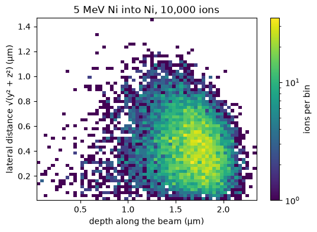
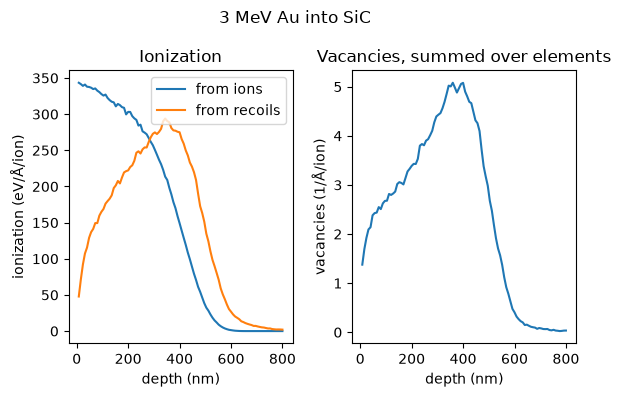
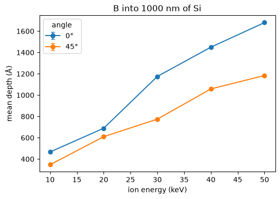
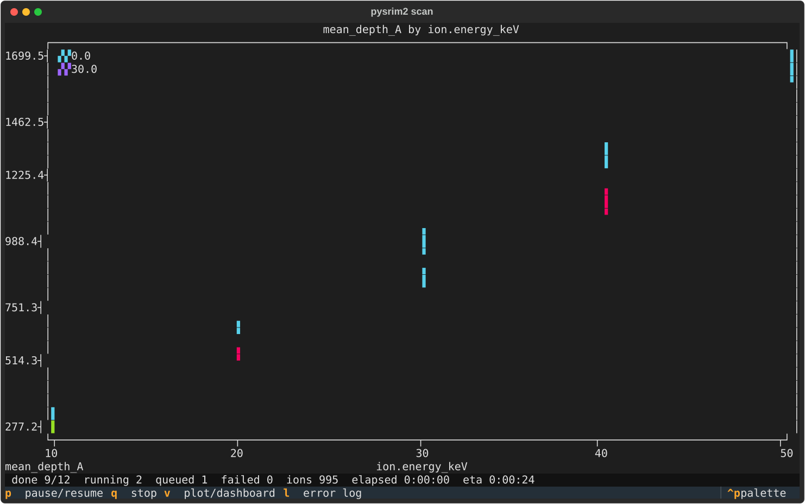
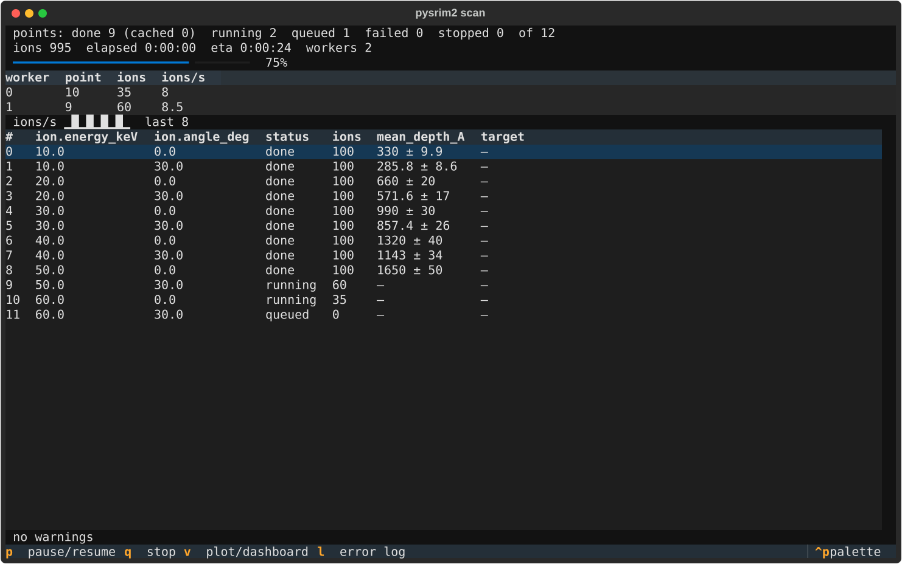
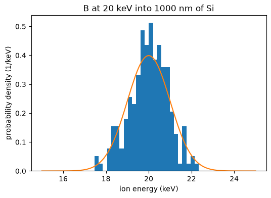
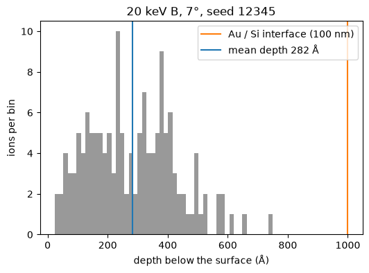

# Gallery

Each picture on this page is made by the script shown under it. The scripts are in
`docs/gallery/`, and one command rebuilds all the pictures from them. The pictures of
SRIM runs use real SRIM output with small ion counts and fixed seeds. The live-view
screenshots use illustrative values from a scripted event stream, not from a SRIM run.

(gallery-heatmap)=
## Where 5 MeV nickel ions stop in nickel (RANGE_3D.txt)



The ions of a 3D range run, counted by depth along the beam and by lateral distance from
it. The data is the SRIM output committed in `test_files/1`, so no SRIM run is needed.

```{literalinclude} gallery/heatmap.py
:language: python
```

(gallery-depth_profiles)=
## Ionization and vacancies against depth



Ionization from ions and from recoils, and the vacancies, against depth for 3 MeV gold
into SiC. The data is the full-cascade output committed in `test_files/2`.

```{literalinclude} gallery/depth_profiles.py
:language: python
```

(gallery-scan_plot)=
## A parameter scan: mean depth against energy, one line per angle



The mean depth of boron ions in silicon from 10 to 50 keV, at 0 and 45 degrees. Each point
is a quick SRIM run, and the points run on two worker processes. Needs SRIM.

```{literalinclude} gallery/scan_plot.py
:language: python
```

(gallery-tui_plot)=
## The live plot of a running scan (pysrim2 scan run --ui plot)



The plot view of a scan while it runs: the finished points and the values so far. The
values are illustrative, from a scripted event stream.

```{literalinclude} gallery/tui_plot.py
:language: python
```

(gallery-tui_dashboard)=
## The scan dashboard (--ui dashboard)



The dashboard view of the same kind of scan: the state of each point and of the workers.
The values are illustrative, as in the picture above.

```{literalinclude} gallery/tui_dashboard.py
:language: python
```

(gallery-beam)=
## A beam with a 1 keV Gaussian energy spread (exact mode)



The energies of 200 boron ions that SRIM ran in exact mode, drawn over the Gaussian
density the beam was defined with. Needs SRIM.

```{literalinclude} gallery/beam.py
:language: python
```

(gallery-agent_boron)=
## The agent example: 200 boron ions into gold on silicon



The depth of the ions in the reference case, with the Au/Si interface and the mean depth
marked. An AI agent with the pysrim2 skill was given this prompt:

> Simulate a 100 nm gold layer on a silicon wafer, implant 200 boron ions at 7 degrees and 20 keV, and give me a pandas DataFrame of implantation depth and xy straggle.

The picture is made by the same boron script that the skill ships, run with seed 12345.
The gallery script calls that script's `run()` function. Needs SRIM. See
{doc}`agents` for the whole agent route.

```{literalinclude} gallery/agent_boron.py
:language: python
```

## Rebuild the pictures

Run from the repository root. The pictures are rebuilt on a machine with SRIM
(`pysrim2 install`); entries that need SRIM are skipped with a message without it.

```shell
uv run --extra plot --extra tui python docs/gallery/make.py          # all entries
uv run --extra plot --extra tui python docs/gallery/make.py --list   # list the entries
uv run --extra plot --extra tui python docs/gallery/make.py heatmap  # one or more names
```

Each committed image must stay under 300 KB.
